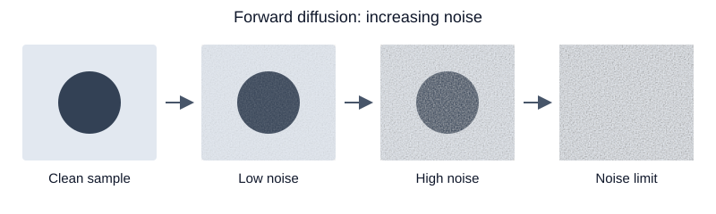

# Introduction

Diffusion models learn to reverse a gradual corruption process. This article focuses on the forward process: starting from a clean sample $x_0 \in \mathbb{R}^d$, we add Gaussian noise over $T$ steps. The formulation follows [Ho, Jain, and Abbeel (2020)](https://arxiv.org/abs/2006.11239).

This draft checks mathematical typesetting, cross-references, static PyTorch code, and an SVG illustration. The diffusion examples are displayed for inspection and are not executed. A separate gradient descent experiment uses executable Python cells to test computation during rendering.

# Mathematical formulation

Let $0 < \beta_t < 1$ be the noise variance at step $t$, and define $\alpha_t = 1 - \beta_t$. A single forward transition is

$$
q(x_t \mid x_{t-1})
= \mathcal{N}\!\left(x_t;\sqrt{\alpha_t}\,x_{t-1},\beta_t I_d\right).
$$ {#eq-forward-transition}

Repeated application of @eq-forward-transition gives a closed-form marginal. With $\bar{\alpha}_t = \prod_{s=1}^{t}\alpha_s$ and $\bar{\alpha}_0 = 1$,

$$
\begin{aligned}
q(x_t \mid x_0)
&= \mathcal{N}\!\left(x_t;\sqrt{\bar{\alpha}_t}\,x_0,(1-\bar{\alpha}_t)I_d\right), \\
x_t
&= \sqrt{\bar{\alpha}_t}\,x_0 + \sqrt{1-\bar{\alpha}_t}\,\epsilon,
\qquad \epsilon \sim \mathcal{N}(0,I_d).
\end{aligned}
$$ {#eq-forward-marginal}

Equation @eq-forward-marginal lets us sample any selected noise level directly, without computing the preceding steps. Conditional on $x_0$, its moments are

$$
\begin{aligned}
\mathbb{E}_{\epsilon}[x_t \mid x_0]
&= \sqrt{\bar{\alpha}_t}\,x_0, \\
\operatorname{Cov}(x_t \mid x_0)
&= (1-\bar{\alpha}_t)I_d.
\end{aligned}
$$ {#eq-forward-moments}

For a two-dimensional sample, the covariance matrix is explicitly

$$
\Sigma_t =
\begin{bmatrix}
1-\bar{\alpha}_t & 0 \\
0 & 1-\bar{\alpha}_t
\end{bmatrix}.
$$

The diagonal entries in this matrix agree with @eq-forward-moments. As $\bar{\alpha}_t$ approaches zero, the signal contribution vanishes and the conditional distribution approaches $\mathcal{N}(0,I_d)$.

# Implementation

The following PyTorch function implements @eq-forward-marginal for a batch of images. `x0` has shape `[batch, channels, height, width]`; `t` is an integer tensor of shape `[batch]`. The schedule stores $T+1$ entries so that code indices match mathematical time: index zero represents the clean sample, and indices 1 through $T$ represent noisy samples.

```python
import torch


def make_alpha_bar(steps, device, dtype):
    betas = torch.linspace(1e-4, 0.02, steps, device=device, dtype=dtype)
    cumulative = torch.cumprod(1.0 - betas, dim=0)
    return torch.cat([torch.ones(1, device=device, dtype=dtype), cumulative])


def forward_diffusion(x0, t, alpha_bar, noise=None):
    """Sample q(x_t | x_0) for each image and return the noise used."""
    if noise is None:
        noise = torch.randn_like(x0)

    # Broadcast one coefficient per image across channels and pixels.
    retained_signal = alpha_bar[t].view(-1, 1, 1, 1)
    signal_scale = retained_signal.sqrt()
    noise_scale = (1.0 - retained_signal).sqrt()
    xt = signal_scale * x0 + noise_scale * noise
    return xt, noise
```

The inputs must share a device, and `noise`, when supplied, must have the same shape and dtype as `x0`. Time indices must lie between zero and `steps`. The example below constructs these inputs explicitly on the CPU.

```python
torch.manual_seed(7)

steps = 1000
side = 32
coordinates = torch.linspace(-1.0, 1.0, side)
yy, xx = torch.meshgrid(coordinates, coordinates, indexing="ij")
disk = (xx.square() + yy.square() < 0.4).float()
clean_image = (2.0 * disk - 1.0)[None, None, :, :]

times = torch.tensor([0, 100, 500, 1000], dtype=torch.long)
clean_batch = clean_image.repeat(len(times), 1, 1, 1)
alpha_bar = make_alpha_bar(steps, clean_batch.device, clean_batch.dtype)
noisy_batch, sampled_noise = forward_diffusion(clean_batch, times, alpha_bar)

# This deliberately long line checks horizontal scrolling in the rendered code block.
diagnostic_message = f"Forward diffusion diagnostics: times={times.tolist()}, batch_shape={tuple(noisy_batch.shape)}, retained_signal_variance={alpha_bar[times].tolist()}"
print(diagnostic_message)

# At t = 0, the signal coefficient is one and the noise coefficient is zero.
assert torch.allclose(noisy_batch[0], clean_batch[0])
```

These are independent samples from the selected marginals, not successive states of one sampled Markov trajectory. The assertion documents an expected boundary condition; no execution results are claimed here. Pixel values are not clipped, because clipping would change the Gaussian corruption distribution.

# Visualization

@fig-forward-diffusion illustrates how recognizable structure becomes less visible as the noise contribution increases.

{#fig-forward-diffusion fig-alt="Four panels connected by arrows: a clean disk, a slightly noisy disk, a heavily noisy disk, and noise with no visible disk." width=100%}

The arrows represent increasing noise levels. The final panel depicts the limiting noise-dominated regime; a finite schedule generally retains a small signal component, as shown in @eq-forward-marginal.

# Executable Scientific Computing

To test the Jupyter engine independently of the diffusion examples, consider the scalar objective $f(x) = (x - 3)^2$. Its analytical gradient is $f'(x) = 2(x - 3)$, so gradient descent updates

$$
x_{k+1} = x_k - \eta\,2(x_k - 3).
$$

Starting from $x_0 = 0$, we use $\eta = 0.1$ for exactly 20 updates. The error obeys $x_{k+1}-3 = 0.8(x_k-3)$, so each step reduces the loss. These executable cells use only built-in Python operations on the CPU; no numerical libraries are imported.

```{python}
#| label: gradient-descent

def objective(x):
    return (x - 3.0) ** 2


def gradient(x):
    return 2.0 * (x - 3.0)


initial_x = 0.0
learning_rate = 0.1
iterations = 20
x = initial_x
history = [(0, x, objective(x))]

for iteration in range(1, iterations + 1):
    x -= learning_rate * gradient(x)
    history.append((iteration, x, objective(x)))

final_loss = objective(x)
assert all(after[2] < before[2] for before, after in zip(history, history[1:]))
assert final_loss < objective(initial_x)
assert abs(x - 3.0) < 0.05, "The final value should be within 0.05 of 3."

print(f"Initial value: {initial_x:.6f}")
print(f"Final value after {iterations} iterations: {x:.6f}")
print(f"Final loss: {final_loss:.8f}")
print("All convergence assertions passed.")
```

The table below is generated from the same computation. Iteration zero records the starting point; the remaining rows show selected updates.

```{python}
#| label: gradient-descent-table
#| output: asis
#| echo: false

print("| Iteration | x | Loss |")
print("| ---: | ---: | ---: |")
for iteration, value, loss in history:
    if iteration in (0, 1, 2, 5, 10, 20):
        print(f"| {iteration} | {value:.6f} | {loss:.8f} |")
print()
```

# Interactive Gradient Descent Explorer

Explore the same objective $f(x) = (x - 3)^2$, starting from $x_0 = 0$ and taking 20 updates. Move the learning-rate slider to recompute the trajectory and summary immediately in your browser.

$$
\begin{aligned}
x_{t+1} &= x_t - 2\eta(x_t - 3), \\
x_{t+1} - 3 &= (1 - 2\eta)(x_t - 3).
\end{aligned}
$$

The error contracts exactly when $|1 - 2\eta| < 1$, so the convergence condition is **$0 < \eta < 1$**. At $\eta = 0.5$, one update reaches the minimum. For $0.5 < \eta < 1$, the parameter oscillates around 3 with decreasing error. At $\eta = 1$, it alternates between 0 and 6 with constant loss 9. Larger learning rates overshoot the minimum so strongly that $|1 - 2\eta| > 1$: each update magnifies the error and the loss diverges.

```{ojs}
//| echo: false
viewof gdEta = Inputs.range([0.05, 1.25], {
  step: 0.05,
  value: 0.2,
  label: "Learning rate η",
  format: value => value.toFixed(2),
  width: Math.min(width, 480)
})
```

```{ojs}
//| echo: false
//| output: false
gdTrajectory = {
  let x = 0;
  const points = [{iteration: 0, x, loss: (x - 3) ** 2}];
  for (let iteration = 1; iteration <= 20; iteration++) {
    x -= 2 * gdEta * (x - 3);
    points.push({iteration, x, loss: (x - 3) ** 2});
  }
  return points;
}

gdFinal = gdTrajectory[gdTrajectory.length - 1]

gdStatus = gdEta < 1
  ? (gdEta === 0.5 ? "Converged in one update" : "Convergent (0 < η < 1)")
  : (gdEta === 1 ? "Non-convergent: constant-loss oscillation" : "Divergent (η > 1)")

gdFormat = value => value === 0 ? "0" : value.toPrecision(7)
```

```{ojs}
//| echo: false
Plot.plot({
  width: Math.min(width, 720),
  height: 320,
  marginLeft: 64,
  marginBottom: 44,
  x: {label: "Iteration", domain: [0, 20], ticks: [0, 5, 10, 15, 20]},
  y: {
    label: "Loss f(x) (symlog)",
    type: "symlog",
    constant: 1,
    domain: [0, Math.max(9, ...gdTrajectory.map(point => point.loss))],
    ticks: 5,
    tickFormat: ".2~s",
    grid: true
  },
  marks: [
    Plot.ruleY([0]),
    Plot.lineY(gdTrajectory, {x: "iteration", y: "loss", stroke: "#2563eb", strokeWidth: 2}),
    Plot.dot(gdTrajectory, {x: "iteration", y: "loss", fill: "#2563eb", r: 3})
  ]
})
```

The vertical axis uses a **symlog scale**: nearly linear close to zero and logarithmic for large losses, so exact zero and divergent trajectories both remain visible. Its upper bound adjusts to the trajectory; tick labels show the actual loss, with `k` for thousands and `M` for millions.

```{ojs}
//| echo: false
html`<div role="status" aria-live="polite" aria-atomic="true">
  <p><strong>After 20 updates from x₀ = 0:</strong></p>
  <ul>
    <li>Learning rate η: <strong>${gdEta.toFixed(2)}</strong></li>
    <li>Final parameter x₂₀: <strong>${gdFormat(gdFinal.x)}</strong></li>
    <li>Final loss f(x₂₀): <strong>${gdFormat(gdFinal.loss)}</strong></li>
    <li>Convergence status: <strong>${gdStatus}</strong></li>
  </ul>
</div>`
```

The status describes the long-run behavior of the update rule; a convergent learning rate need not reach the minimum within these 20 updates.

# Conclusion

The forward process combines a scaled clean sample with Gaussian noise. Its closed-form marginal provides a compact implementation and makes the signal and noise contributions explicit.

This article is a rendering fixture rather than a diffusion-model benchmark. The gradient descent experiment additionally checks Python execution, numerical assertions, and a generated table. Visual review should confirm these outputs alongside equation numbering and links, matrix and alignment layout, section navigation, code highlighting and copy buttons, horizontal scrolling, and the figure caption and reference. Executing the PyTorch diffusion examples and modeling the reverse process remain outside this phase.
